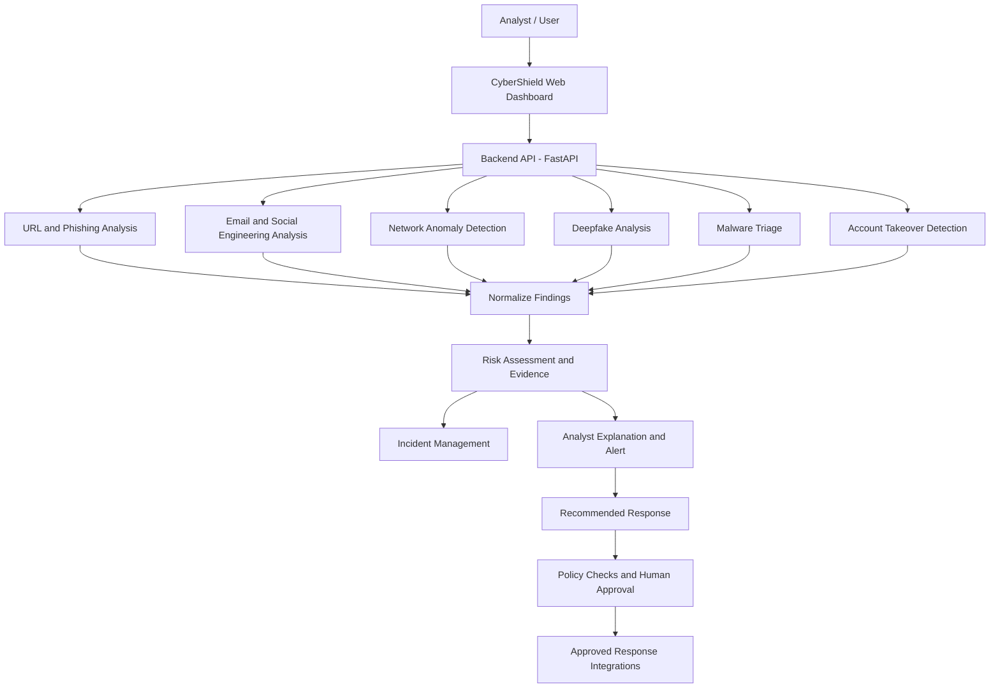

# CyberShield — AI-Powered Cyber Threat Detection & Response

> **Project status:** Active development  
> **Problem statement:** PS9 — AI-powered cyber threat, phishing and digital impersonation detection and response system  
> **Repository:** Coming soon  
> **Project type:** AI/ML · Cybersecurity · Threat Intelligence · Security Operations Automation

CyberShield is a cybersecurity platform designed to help security analysts identify suspicious activity, classify potential threats, assess risk, understand detection evidence, and choose appropriate response actions through a unified dashboard.

The project combines machine-learning-based detection with security analysis and a planned agentic workflow to help reduce the manual effort involved in reviewing multiple types of cyber threats.

**Important:** CyberShield is a project under development. Some detection and analysis modules have been implemented, while live network-flow classification, end-to-end automation, and additional integrations remain under development or validation. This repository will document verified capabilities as they become available.

---

## Table of Contents

- [Overview](#overview)
- [Key Features](#key-features)
- [Threat Detection Modules](#threat-detection-modules)
- [Detection-to-Response Workflow](#detection-to-response-workflow)
- [Technology Stack](#technology-stack)
- [Datasets and Model References](#datasets-and-model-references)
- [Deepfake Detection Integration](#deepfake-detection-integration)
- [System Architecture](#system-architecture)
- [Installation](#installation)
- [Configuration](#configuration)
- [Running the Application](#running-the-application)
- [API and Integration Status](#api-and-integration-status)
- [Project Structure](#project-structure)
- [Team and Contributions](#team-and-contributions)
- [Limitations and Responsible Use](#limitations-and-responsible-use)
- [Future Work](#future-work)
- [Contributing](#contributing)
- [Acknowledgements and Citations](#acknowledgements-and-citations)
- [License](#license)

---

## Overview

Cyber threats increasingly involve multiple attack vectors, including malicious URLs, phishing messages, manipulated media, suspicious network behavior, malware, and compromised user accounts.

Traditional workflows can require analysts to switch between separate tools, manually correlate evidence, determine severity, prepare reports, and decide what action to take.

CyberShield aims to bring these activities into a unified security operations workflow.

### Our objectives

- Detect potential cyber threats using specialized machine-learning and analysis modules.
- Analyze suspicious URLs and email content for phishing and social-engineering indicators.
- Examine submitted media for possible deepfake manipulation.
- Identify anomalous network behavior and suspicious technical activity.
- Support malware triage and account-takeover detection.
- Present findings, risk indicators, and explanations through a unified dashboard.
- Help analysts prioritize incidents and select appropriate response actions.
- Progress toward controlled automation while preserving human oversight for sensitive actions.

CyberShield is intended to support security analysts and organizations, as well as students and developers exploring applied AI in cybersecurity.

---

## Key Features

### 1. Phishing and malicious URL analysis

Analyze a submitted URL using a dedicated phishing-detection model and available enrichment services.

Intended capabilities include:

- URL and website feature analysis.
- Phishing-versus-legitimate classification.
- Risk scoring and severity categorization.
- Threat-intelligence enrichment when supported sources are available.
- Explanations and recommended next steps.

**Dataset:** PhiUSIIL Phishing URL Dataset.

### 2. Email and social-engineering analysis

Analyze email sender information, subject lines, and message content for suspicious patterns.

Detection indicators may include:

- Urgency and pressure tactics.
- Threats involving account suspension or restricted access.
- Requests for credentials or identity verification.
- Financial manipulation.
- Impersonation-related language.
- Suspicious attachment lures.
- URLs and domains extracted from email text.

When URLs are present, the workflow can attempt to use the URL-analysis service for additional evidence.

### 3. Deepfake analysis and detection

Analyze submitted images or supported media inputs for possible synthetic or manipulated content.

The project uses a CLIP ViT-B/16-based approach, with DF40 as a deepfake research dataset reference.

The exact preprocessing, model weights, inference method, and performance must be documented against the implementation actually deployed in this repository.

### 4. Network anomaly and technical-behavior detection

Use a trained machine-learning pipeline to evaluate structured network-flow features and identify traffic patterns associated with potential threats.

The current Model 3 design uses:

- **Dataset:** CIC-IDS2017.
- **Classifier:** HistGradientBoosting.
- **Input:** A structured vector of 67 network-flow features in the current production artifact.

A trained model accepting a feature vector is not, by itself, proof of live network monitoring. Reliable live classification requires validated packet capture, flow construction, feature extraction, and compatibility checks.

### 5. Malware triage

Support preliminary analysis and prioritization of potentially malicious files using a dedicated malware-analysis model.

The project has a LightGBM-based malware model artifact. Supported file formats, extraction methods, model input requirements, and detection performance should be documented and tested before release.

Malware triage is intended to support investigation, not to replace sandboxing, endpoint protection, or forensic analysis.

### 6. Account-takeover detection

A separate account-takeover detection capability is part of the project scope.

Its final dataset, features, model, evaluation results, and production integration should be documented when those components are validated.

### 7. Security operations dashboard

The dashboard is intended to give analysts a unified view of:

- Detection results and incident records.
- Risk scores and severity levels.
- Evidence and explanations.
- Available threat-intelligence findings.
- Recommendations and response status.
- Operational telemetry and analysis health.

The availability of each dashboard feature depends on the corresponding backend integration.

---

## Threat Detection Modules

| Module | Dataset or source | Model or approach | Status |
|---|---|---|---|
| Phishing and URL detection | PhiUSIIL | Dedicated phishing classifier; Random Forest is used in the project’s URL-analysis stack | Implemented; verify current API and model health |
| Email and social-engineering analysis | Submitted email content and extracted URLs | Rule-based indicators combined with URL-analysis results | Implemented; further validation required |
| Network anomaly detection | CIC-IDS2017 | HistGradientBoosting Classifier | Model artifact available; live-flow validation ongoing |
| Deepfake detection | DF40 research dataset | CLIP ViT-B/16-based approach | Integration reported; validate inference configuration |
| Malware triage | Project-specific model inputs and training data | LightGBM model artifact | Model artifact available; document supported inputs and validation |
| Account-takeover detection | To be documented | To be documented | Training and integration details to be confirmed |
| Agentic response workflow | Detection outputs and incident evidence | Planned orchestration, policy checks, and analyst approval | In development |

The table describes the current project direction and known implementation state. It is not a claim that all modules are production-ready or that their models achieve any particular accuracy.

---

## Detection-to-Response Workflow

CyberShield is designed around the following workflow:

**Detection → Classification → Risk Assessment → Explanation → Alert → Recommended Response → Controlled Action**

### Stage 1 — Detection

A module analyzes an input such as a URL, email, image, network flow, or file.

The system should retain the source and type of input so that findings from different modules are not confused.

### Stage 2 — Classification

The appropriate model or analysis component produces a prediction, such as a potential phishing URL, suspicious network flow, or possible deepfake.

Classification must be based on the evidence and input type supported by that particular model.

### Stage 3 — Risk assessment

The workflow combines available evidence into a risk assessment.

A risk score is not automatically the same as a calibrated probability. Its meaning should be documented, including the thresholds used to assign severity.

### Stage 4 — Explanation

The analyst receives relevant evidence, such as triggered indicators, suspicious URL characteristics, model output, or available threat-intelligence matches.

Explanations should distinguish observed facts from model inferences.

### Stage 5 — Alert and incident management

The platform can record findings and present them for analyst review. Incident records should include timestamps, source information, severity, and investigation context where supported.

### Stage 6 — Recommended response

The system suggests actions appropriate to the threat and the available evidence.

Possible recommendations include:

- Review and escalate an incident.
- Block a confirmed malicious URL through an approved control.
- Quarantine a suspicious file in a controlled environment.
- Investigate unusual network activity.
- Request additional identity verification.
- Preserve evidence for incident response.

These are examples of possible recommendations, not a claim that every action is currently automated.

### Stage 7 — Controlled action

Future agentic orchestration can coordinate approved actions through integrated security tools.

High-impact actions should require appropriate authorization, policy validation, audit logging, and human approval. An AI prediction alone should not trigger an irreversible response.

---

## Technology Stack

The project uses or is designed around the following technologies. Exact versions should be recorded in the repository's dependency and lock files.

| Layer | Technologies |
|---|---|
| Frontend | React, TypeScript, Vite, Tailwind CSS |
| Backend API | Python, FastAPI |
| Machine learning | scikit-learn, LightGBM, PyTorch |
| URL and email analysis | Python-based analysis services and model integration |
| Deepfake analysis | CLIP ViT-B/16-based workflow |
| Data processing | pandas, NumPy |
| Network analysis | Structured flow features and packet/flow extraction tooling |
| Incident management | Backend incident records and analysis metadata |
| Future integrations | Security tools, threat-intelligence providers, and approved response APIs |

Some components may use additional dependencies. Refer to the actual dependency files before installing or deploying.

---

## Datasets and Model References

The datasets below are research or training references. Their use does not imply that every sample is included in the repository or that the project was trained from scratch on every dataset.

### 1. PhiUSIIL Phishing URL Dataset

- **Purpose:** Phishing URL and website classification.
- **Publisher:** UCI Machine Learning Repository.
- **Size:** 235,795 instances and 54 features, according to the dataset record.
- **License:** CC BY 4.0, subject to the dataset's attribution requirements.

Links:

- [Official dataset page](https://archive.ics.uci.edu/dataset/967/phiusil-phishing-url-dataset)
- [Dataset paper DOI](https://doi.org/10.1016/j.cose.2023.103545)

The dataset contains legitimate and phishing examples with URL and website-derived features. Its original class labels use `1` for legitimate and `0` for phishing, so confirm the label mapping used by any preprocessing or trained model.

### 2. CIC-IDS2017

- **Purpose:** Network intrusion and anomaly detection research.
- **Publisher:** Canadian Institute for Cybersecurity, University of New Brunswick.
- **Data types:** Network packet captures and labeled flow data.
- **Project model:** HistGradientBoosting Classifier using a 67-feature production schema.

Links:

- [Official CIC-IDS2017 dataset page](https://www.unb.ca/cic/datasets/ids-2017.html)
- [CICFlowMeter repository](https://github.com/ahlashkari/CICFlowMeter)

The dataset includes benign traffic and multiple attack scenarios. For reproducible inference, the flow extractor must generate features in the same order, with the same definitions and units expected by the trained model.

### 3. DF40 — Deepfake Detection Dataset

- **Purpose:** Research and evaluation of deepfake detection across different generation methods.
- **Project approach:** CLIP ViT-B/16-based image analysis.
- **Original research:** *DF40: Toward Next-Generation Deepfake Detection*.

Links:

- [Official DF40 repository](https://github.com/YZY-stack/DF40)
- [DF40 paper](https://arxiv.org/abs/2406.13495)
- [OpenAI CLIP repository](https://github.com/openai/CLIP)
- [OpenAI CLIP model card](https://github.com/openai/CLIP/blob/main/model-card.md)

DF40 contains data generated by multiple manipulation methods and includes image/video research resources. The upstream repository describes large dataset downloads and provides its own training and inference workflows.

**Integration note:** CyberShield's use of CLIP ViT-B/16 should not be confused with using the original DF40-trained CLIP checkpoint. Record the exact model weights, preprocessing, prompts or classification head, and training/fine-tuning procedure used by CyberShield.

The upstream DF40 repository specifies a **CC BY-NC 4.0** license for its dataset and code. Review the upstream terms before redistributing its assets or using them commercially.

### 4. Malware and account-takeover data

The exact datasets, licenses, and splits for the malware triage and account-takeover modules must be added after the training sources have been verified.

Do not publish confidential, proprietary, or restricted datasets. Where a dataset cannot be redistributed, provide its official source and acquisition instructions instead.

---

## Deepfake Detection Integration

The deepfake module is intended to provide a media-analysis capability inside the broader CyberShield workflow.

### High-level processing flow

1. The user submits an image or supported media input through the analysis interface.
2. The backend validates the input type and size.
3. The media is preprocessed according to the configured model's requirements.
4. The CLIP ViT-B/16-based component performs its configured inference.
5. The backend returns the supported prediction and analysis metadata.
6. The dashboard displays the result for review.
7. If integrated with incident management, the result can become evidence for an investigation or risk assessment.

### Important implementation details to document

- Accepted formats and maximum upload size.
- Image resizing, face detection, cropping, and normalization.
- Exact CLIP checkpoint and whether any fine-tuning is applied.
- How the real/fake classification is produced.
- Whether video inputs are processed frame-by-frame.
- Evaluation datasets, train/validation/test splits, and metrics.
- GPU and CPU requirements.
- API endpoint and response schema.
- Failure handling for unsupported or low-quality inputs.

### Known limitations

A generic pretrained CLIP model does not automatically constitute a validated deepfake detector. The classification method must be specified and evaluated for the intended task. Results should be treated as supporting evidence rather than definitive proof that a media file is authentic or manipulated.

---

## System Architecture

The intended high-level architecture is shown below.



This diagram represents the intended architecture, not a guarantee that all modules already share a single orchestration service. The final repository should document actual API routes, data contracts, and integration boundaries.

### Architecture principles

- **Modularity:** Detection models should remain independently testable.
- **Consistent contracts:** Each module should return a documented result format.
- **Evidence-based decisions:** Risk assessments should preserve their supporting indicators.
- **Human oversight:** Sensitive response actions should be gated by explicit policy.
- **Auditability:** Record the input source, analysis time, model version, result, and approved action where appropriate.
- **Graceful degradation:** A failed threat-intelligence service should be reported as unavailable, not treated as proof that an indicator is safe.
- **Privacy:** Restrict access to uploaded media, emails, network data, and incident records.

---

## Installation

The repository is marked as **coming soon**. Once it is published, replace the placeholder repository URL and verify these commands against the committed files.

### Prerequisites

- Git
- Python 3.11, matching the current development environment
- Node.js and npm versions compatible with the frontend lock file
- A terminal such as PowerShell on Windows
- Optional: compatible NVIDIA GPU and CUDA setup for workloads that support GPU acceleration

### 1. Clone the repository

```bash
git clone <YOUR-GITHUB-REPOSITORY-URL>
cd <YOUR-REPOSITORY-DIRECTORY>
```

The repository URL is a placeholder until the project is published.

### 2. Create and activate the Python environment

**Windows PowerShell**

```powershell
py -3.11 -m venv .venv
.\.venv\Scripts\Activate.ps1
python -m pip install --upgrade pip
```

If PowerShell blocks activation scripts, you can invoke the environment's Python directly instead of changing machine-wide execution policies:

```powershell
.\.venv\Scripts\python.exe -m pip install --upgrade pip
```

### 3. Install backend dependencies

If the repository contains a backend requirements file:

```powershell
.\.venv\Scripts\python.exe -m pip install -r backend\requirements.txt
```

If the project uses `pyproject.toml`, Poetry, or another dependency manager, follow the committed configuration instead. Do not create a new requirements file by guessing dependencies.

### 4. Install frontend dependencies

```powershell
Set-Location frontend\cybergurad-dashboard
npm ci
```

Use `npm ci` when the repository includes a compatible `package-lock.json`. Otherwise, use the package manager and lock file committed by the project.

### 5. Configure environment variables

Create the required local environment files from the project's example files, if provided.

```powershell
Copy-Item .env.example .env
```

The actual location and required variables must be confirmed from the published repository. Do not commit API keys, credentials, tokens, or private dataset paths.

### 6. Download model artifacts

Download or place model artifacts using the instructions provided by the repository maintainers.

Large models and restricted datasets may be hosted separately. Verify their source, checksum, licensing, and compatibility before loading them.

### 7. Start the backend

From the project root, the current development setup has used the following launch command:

```powershell
$env:PYTHONPATH = "$(Get-Location)\backend;$(Get-Location)"
.\.venv\Scripts\python.exe -m uvicorn app.main:app --app-dir ".\backend" --host 127.0.0.1 --port 8000 --reload
```

This command assumes the backend entry point remains `backend/app/main.py` and that dependencies and required settings are installed.

Keep the backend terminal open. If startup fails, resolve the reported dependency, import, model-path, or configuration issue before proceeding.

### 8. Start the frontend

Open a second terminal:

```powershell
Set-Location "frontend\cybergurad-dashboard"
npm run dev
```

Open the local URL printed by Vite.

Configure the frontend API base URL according to the actual project environment configuration. The current development code has used `http://localhost:8000` as a default, while the phishing API module has used `http://127.0.0.1:8000/api/v1`. Verify and standardize these settings before release.

### 9. Verify the setup

Before using the dashboard, verify:

- The frontend loads.
- The backend starts without import errors.
- The API health endpoint responds, if implemented.
- Required model artifacts load successfully.
- A test request returns the documented response schema.
- Failed model or enrichment calls are reported clearly.
- The frontend displays unavailable results without crashing.

Use benign test inputs and an isolated test environment. Some analysis requests may create incident records.

---

## Configuration

The final repository should include an `.env.example` documenting supported variables, without real secrets.

Potential configuration areas include:

| Setting | Purpose |
|---|---|
| Backend host and port | Local API binding |
| Frontend API base URL | Frontend-to-backend communication |
| Model artifact paths | Locations of trained models |
| Upload size limits | Safe handling of media and files |
| Request timeout | Bound external or model-processing operations |
| Threat-intelligence credentials | Optional enrichment providers |
| Logging level | Development and diagnostic output |
| Database settings | Incident storage, if database-backed storage is configured |

Only variables actually read by the code should be included in the final example file.

For local development, bind to `127.0.0.1` unless remote access is specifically required. Do not expose an unauthenticated development server directly to the public internet.

---

## API and Integration Status

The backend is intended to expose analysis services through FastAPI. The exact routes and request schemas should be verified from the final OpenAPI documentation.

Known development route patterns have included:

| Purpose | Example route | Notes |
|---|---|---|
| URL analysis | `POST /api/v1/analyze/url` | Verify authentication, request schema, and health route |
| Network-flow analysis | `POST /api/v1/analyze/network` | Requires the expected flow feature schema |
| Network model health | `GET /api/v1/analyze/network/health` | Previously used to report model readiness |
| Network preset retrieval | `GET /api/v1/network/preset/normal` | Development preset; not a live traffic feed |
| Sysmon telemetry | `GET /api/v1/telemetry/sysmon/events` | Observed telemetry is not automatically a model prediction |

These routes describe the known development interface and may change. Use the running application's OpenAPI specification as the source of truth.

### Live network detection

Real-time network classification requires more than collecting operating-system connection events. The collector and flow extractor must produce compatible model features, and each flow must pass validation before inference.

Partial or unsupported flow records must not be silently classified as benign. Where feature coverage is insufficient, the system should return an explicit unevaluated or unavailable status.

### Response automation

The long-term objective is to coordinate detection, risk assessment, explanation, alerting, and response suggestions. Automated blocking, quarantine, or account changes should only be enabled after authorization, safety controls, and audit logging are implemented and tested.

---

## Project Structure

The following is a conceptual guide based on the development layout. It is not a complete file listing.

```text
CyberShield/
├── backend/
│   └── app/
│       ├── main.py
│       ├── api/
│       │   └── v1/
│       ├── schemas/
│       └── services/
├── frontend/
│   └── cybergurad-dashboard/
│       ├── src/
│       │   ├── api/
│       │   ├── components/
│       │   ├── hooks/
│       │   ├── pages/
│       │   └── routes/
│       └── package.json
├── models/
│   ├── behavior/
│   └── future/
├── tools/
├── data/
├── .gitignore
└── README.md
```

The actual spelling and names of directories should be preserved from the published repository. Large datasets, private logs, secrets, and model artifacts should be excluded from Git where appropriate and distributed through documented, permission-compatible channels.

---

## Team and Contributions

CyberShield is being developed collaboratively, with responsibilities across model development, backend and frontend integration, resource support, and presentation.

| Contributor | Role and contribution |
|---|---|
| **Satyapriya Tripathy** | Team leader; development of URL analysis, NLP-based email content analysis, deepfake detection, network anomaly and technical-behavior detection; backend and frontend integration; dashboard development; ongoing work on live feeds and automation |
| **Bimal Kumar Naik** | Resource support, including computer and internet access, project feedback, and testing observations |
| **Rohit Kumar Prajapati** | Presentation preparation and communication of the project |
| **Soumya Ranjan Mishra** | Malware triage model training |
| **Abhay Das** | Account-takeover model training |

Contributions may evolve as development progresses. Before publishing, confirm that every contributor agrees with the wording and that the table accurately reflects the work performed.

---

## Limitations and Responsible Use

CyberShield is an evolving project and should not be treated as a complete enterprise security product without further testing.

- Model predictions may contain false positives and false negatives.
- Risk scores should not be presented as calibrated probabilities unless calibration has been measured.
- A benign prediction does not guarantee that an input is safe.
- Missing threat-intelligence results do not prove that a URL or domain is legitimate.
- Deepfake analysis cannot guarantee authenticity or manipulation.
- Network detection depends on valid flow construction and feature compatibility.
- Model outputs should be evaluated against held-out data and representative test conditions.
- Malware analysis should be performed in an appropriately isolated environment.
- Response actions should require authorization, least privilege, and auditability.
- Do not upload confidential emails, personal images, credentials, or sensitive network records to untrusted environments.

Use the platform only on systems, data, and networks for which you have authorization.

---

## Future Work

Planned improvements include:

1. **Live network monitoring:** Validated packet capture, bidirectional flow construction, and feature extraction compatible with the network model.
2. **Agentic orchestration:** Coordinating detection, classification, risk assessment, explanation, alerting, and recommendations through a controlled workflow.
3. **Human-approved response actions:** Policy-gated integrations for approved blocking, quarantine, escalation, and account-protection operations.
4. **Unified incident management:** Correlation of findings from different detection modules with consistent identifiers and audit trails.
5. **Improved explainability:** Clear evidence summaries and documented score semantics.
6. **Model evaluation:** Reproducible test splits, confusion matrices, precision, recall, F1-score, calibration checks, and robustness testing.
7. **Deepfake evaluation:** Testing across different manipulation methods, image qualities, and supported media types.
8. **Malware triage improvements:** Safer file handling, additional indicators, and reproducible evaluation.
9. **Account-takeover integration:** Documented data sources, model validation, and backend integration.
10. **Deployment hardening:** Authentication, authorization, secure configuration, logging, rate limiting, and containerized deployment.
11. **Documentation and testing:** API reference, installation validation, automated tests, and deployment guides.

These are development goals, not commitments that the capabilities are already available.

---

## Contributing

Contributions, testing feedback, and suggestions are welcome once the repository is published.

A useful contribution should:

1. Describe the issue or proposed improvement.
2. Identify the affected module.
3. Include reproducible steps where possible.
4. Add or update tests for behavior changes.
5. Document new dependencies, configuration, and data requirements.
6. Avoid including secrets, private data, or datasets without redistribution permission.

Please do not commit downloaded datasets or model weights until their licenses and repository size implications have been reviewed.

---

## Acknowledgements and Citations

CyberShield builds on publicly available research resources. Please consult the original project documentation and licenses before redistributing or using any third-party data, code, or model weights.

**PhiUSIIL Phishing URL Dataset**

Prasad, A., & Chandra, S. (2024). *PhiUSIIL Phishing URL (Website) Dataset*. UCI Machine Learning Repository. [https://doi.org/10.1016/j.cose.2023.103545](https://doi.org/10.1016/j.cose.2023.103545)

**CIC-IDS2017**

Sharafaldin, I., Lashkari, A. H., & Ghorbani, A. A. (2018). *Toward Generating a New Intrusion Detection Dataset and Intrusion Traffic Characterization*. Proceedings of the International Conference on Information Systems Security and Privacy. Refer to the [official CIC-IDS2017 page](https://www.unb.ca/cic/datasets/ids-2017.html) for the dataset and publication details.

**DF40**

Yan, Z., et al. (2024). *DF40: Toward Next-Generation Deepfake Detection*. [arXiv:2406.13495](https://arxiv.org/abs/2406.13495). Refer to the [official DF40 repository](https://github.com/YZY-stack/DF40) for citation and license instructions.

**CLIP**

Radford, A., et al. (2021). *Learning Transferable Visual Models From Natural Language Supervision*. [OpenAI CLIP repository](https://github.com/openai/CLIP).

Please cite additional datasets, model implementations, and libraries as required by their maintainers.

---

## License

The license for the CyberShield source code has not yet been specified.

Before publishing, choose and add a root-level `LICENSE` file. Do not imply that third-party datasets, checkpoints, or dependencies share the CyberShield code license.

Third-party assets remain subject to their original licenses. In particular, review the DF40 **CC BY-NC 4.0** terms before any commercial use or redistribution.

---

## Project Status

CyberShield is an active development project focused on bringing multiple AI-assisted security detection capabilities into one analyst-oriented workflow.

The long-term vision is to help security teams move from isolated detections toward a structured, explainable, and controlled response process.

**Detect. Understand. Prioritize. Respond responsibly.**
