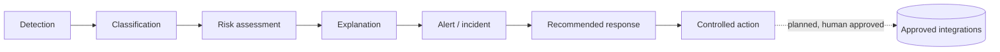
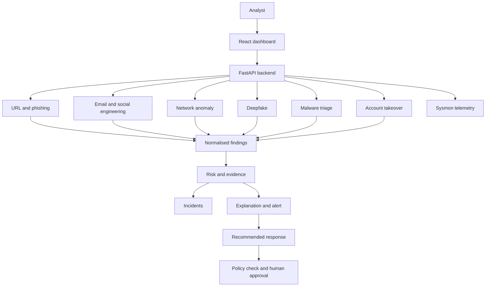
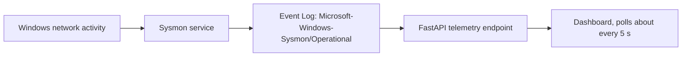

<div align="center">

# CyberShield

**AI-powered cyber threat, phishing and digital impersonation detection and response.**

One analyst-oriented workflow for URLs, emails, media, network behaviour and files, from detection to recommended response.


[Capabilities](#capabilities) · [Workflow](#detection-to-response-workflow) · [Quick start](#quick-start-windows) · [Installation guide](#full-installation-guide) · [API](#api-reference) · [Roadmap](#roadmap) · [Team](#team)

</div>

> [!NOTE]
> **Naming:** the product is **CyberShield**; this repository is named **Evident**. The React dashboard folder is `cybergurad-dashboard` (spelling as committed).
>
> **Status:** CyberShield is under active development. Some modules are implemented, others are being validated or built. This README says which is which. Nothing here is a claim of accuracy, completeness or production readiness.

---

## Why CyberShield

Threats arrive through many channels at once: malicious links, phishing emails, manipulated media, suspicious network behaviour, malware and compromised accounts. Analysts often check each in a separate tool, correlate evidence by hand, and decide on severity and next steps without enough context.

CyberShield's goal is a single, explainable investigation workflow:

- **Detect** with specialised machine-learning and analysis modules.
- **Explain** each finding with the evidence behind it, not only a label.
- **Prioritise** with a shared risk and severity view.
- **Recommend** next steps while keeping a human in control of sensitive actions.

Built for security analysts, SOC teams and administrators, and for students and developers exploring applied AI in cybersecurity.

## At a glance

| | |
|---|---|
| **Problem statement** | PS9: AI-powered cyber threat, phishing and digital impersonation detection and response system |
| **Backend** | Python 3.11, FastAPI, Uvicorn |
| **Frontend** | React, TypeScript, Vite, Tailwind CSS |
| **ML** | scikit-learn, LightGBM, PyTorch, pandas, NumPy |
| **Live telemetry** | Windows Sysmon (Event ID 3, network connections) through a FastAPI endpoint |
| **Human oversight** | Recommendations only; automated response is not enabled |
| **License** | Not yet specified (see [License](#license)) |

---

## Capabilities

Status key: **Implemented** (working, still being validated) · **Validating** (artifact exists, evaluation or integration ongoing) · **In development** (not usable yet).

| Module | What it does | Data / model | Status |
|---|---|---|---|
| **Phishing and URL analysis** | Classifies a URL, adds risk score, severity and threat-intelligence enrichment when sources are available | PhiUSIIL dataset; Random Forest in the URL stack | Implemented |
| **Email and social-engineering analysis** | Flags urgency, account-suspension threats, credential requests, financial manipulation, impersonation language and attachment lures; extracts URLs and sends them to URL analysis | Rule-based indicators plus URL results | Implemented |
| **Network anomaly detection** | Classifies structured network-flow records | CIC-IDS2017; HistGradientBoosting; 67-feature input | Validating (live-flow classification not yet validated) |
| **Windows Sysmon telemetry** | Reads and exposes recent Sysmon network-connection events to the dashboard | Windows Event Log | Implemented (observations, not predictions) |
| **Deepfake analysis** | Analyses submitted images for possible manipulation | CLIP ViT-B/16-based approach; DF40 as research reference | Validating |
| **Malware triage** | Preliminary file analysis and prioritisation | LightGBM model artifact | Validating |
| **Account-takeover detection** | Detects likely account compromise | To be documented | In development |
| **Agentic response workflow** | Orchestrated, policy-checked, analyst-approved actions | Detection outputs and incident evidence | In development |
| **Security dashboard** | Findings, incidents, severity, evidence, telemetry and recommendations | React app | Available; each view depends on its backend integration |

> [!IMPORTANT]
> **Telemetry is not detection.** A Sysmon event shown in the dashboard is an observation. It is not an AI-classified threat and has no risk score unless a model evaluation is run separately. Live classification needs validated packet capture, flow construction and feature extraction that match the trained model.

---

## Detection-to-response workflow



| Stage | What happens |
|---|---|
| **1. Detection** | A module receives a URL, email, image, network flow or file. The input type is kept so results from different modules are never mixed up. |
| **2. Classification** | The appropriate model or rule set produces a finding, using only the evidence that module supports. |
| **3. Risk assessment** | Available results and evidence are combined into severity. A risk score is not a calibrated probability unless calibration has been measured. |
| **4. Explanation** | The analyst sees the supporting indicators, separating observed facts from model inferences. |
| **5. Alert / incident** | Findings are recorded with timestamps, source and severity for review. |
| **6. Recommended response** | Suggested actions: escalate, block a confirmed malicious URL through an approved control, quarantine a file in a controlled environment, investigate network activity, request identity verification, preserve evidence. |
| **7. Controlled action** | *Planned.* Approved actions through integrated tools, behind authorisation, policy checks, audit logging and human approval. A prediction alone must not trigger an irreversible response. |

Recommendations and automated actions are different things. Today CyberShield recommends; it does not remediate.

---

## Architecture



This is the intended architecture. Treat the running app's OpenAPI document as the source of truth for actual routes and schemas.

**Design principles:** modular detectors that can be tested alone; a consistent result contract per module; evidence preserved with every score; human approval for sensitive actions; audit-friendly records (input source, time, model version, result); a failed enrichment service is reported as *unavailable*, never as *safe*; and restricted access to uploaded media, emails and network data.

### Windows live-telemetry path



Sysmon is a separate Windows service. Starting the backend or frontend does **not** install or start it.

---

## Quick start (Windows)

Minimal path to a running dashboard. Everything in this section is expanded in the [full guide](#full-installation-guide).

**Prerequisites:** Windows 10/11, [Python 3.11](https://www.python.org/downloads/), [Node.js LTS](https://nodejs.org/), [Git](https://git-scm.com/downloads). [Sysmon](https://learn.microsoft.com/en-us/sysinternals/downloads/sysmon) is needed only for live telemetry.

```powershell
# 1. Clone
git clone https://github.com/Satyapt001/Evident.git
cd Evident

# 2. Backend environment
py -3.11 -m venv .venv
.\.venv\Scripts\Activate.ps1
python -m pip install --upgrade pip setuptools wheel
pip install -r .\backend\requirements.txt

# 3. Start the backend (keep this terminal open)
$env:PYTHONPATH = "$(Get-Location)\backend;$(Get-Location)"
python -m uvicorn app.main:app --app-dir ".\backend" --host 127.0.0.1 --port 8000 --reload
```

In a **second** terminal:

```powershell
cd Evident\frontend\cybergurad-dashboard
npm ci
npm run dev
```

Then open <http://localhost:5173> (or the address Vite prints) and the API docs at <http://127.0.0.1:8000/docs>.

> [!WARNING]
> The commands reflect the project structure used so far. Check them against the files in this repository (for example where `requirements.txt` lives) before treating them as a clean-machine-tested procedure.

---

## Full installation guide

<details>
<summary><b>1. Prerequisites and verification</b></summary>

| Software | Version | Download |
|---|---|---|
| Operating system | Windows 10/11 | Microsoft |
| Python | 3.11 | https://www.python.org/downloads/ |
| Node.js | LTS | https://nodejs.org/ |
| Git | Latest stable | https://git-scm.com/downloads |
| Sysmon (live telemetry only) | Latest compatible | https://learn.microsoft.com/en-us/sysinternals/downloads/sysmon |

```powershell
python --version
py --version
node --version
npm --version
git --version
```

If a command is not recognised, install the software, make sure it is on `PATH`, and reopen PowerShell. Installing Sysmon needs an Administrator account.

</details>

<details>
<summary><b>2. Backend environment</b></summary>

```powershell
py -3.11 -m venv .venv
.\.venv\Scripts\Activate.ps1
python -m pip install --upgrade pip setuptools wheel
```

If PowerShell blocks activation, relax the policy for **this terminal only**, then activate again:

```powershell
Set-ExecutionPolicy -Scope Process -ExecutionPolicy Bypass
```

Install the requirements file the repository actually contains. Check first, and do not install both:

```powershell
Test-Path .\backend\requirements.txt
Test-Path .\requirements.txt
pip install -r .\backend\requirements.txt   # or: pip install -r .\requirements.txt
python -m pip check
```

`pip check` reports dependency conflicts. `(.venv)` in the prompt means the environment is active.

</details>

<details>
<summary><b>3. Environment variables</b></summary>

If the repository provides `.env.example` (or `.env.template`), copy it and fill in only the variables the backend actually reads:

```powershell
Copy-Item .env.example .env
# or, if the template is in the backend folder:
Copy-Item backend\.env.example backend\.env
```

Never commit API keys, passwords, credentials, private certificates or real secrets, and keep `.env` out of Git. Commit an `.env.example` with placeholders only.

| Setting | Purpose |
|---|---|
| Backend host and port | Local API binding |
| Frontend API base URL | Frontend-to-backend communication |
| Model artifact paths | Location of trained models |
| Upload size limits | Safe handling of media and files |
| Request timeout | Bound model and external calls |
| Threat-intelligence credentials | Optional enrichment providers |
| Logging level | Diagnostics |
| Database settings | Incident storage, if configured |

Bind to `127.0.0.1` for local work. Do not expose an unauthenticated development server to the internet.

**Model artifacts:** large models and restricted datasets may be hosted separately. Follow the maintainers' instructions and verify source, checksum, licence and compatibility before loading anything.

</details>

<details>
<summary><b>4. Sysmon (Windows live telemetry, optional)</b></summary>

Sysmon is a Microsoft Sysinternals service and driver that writes configured events to the Windows Event Log. Event ID 3 (network connection) is **off by default** and must be enabled in the configuration. It records connections, not packets or bytes transferred.

1. Download Sysmon from the official page, extract it, and put `Sysmon64.exe` somewhere convenient, for example `C:\Tools\Sysmon\`.
2. Open **PowerShell as Administrator** and go to that folder.
3. Check the schema version your binary supports:

```powershell
cd C:\Tools\Sysmon
.\Sysmon64.exe -s
```

4. If the project ships a reviewed Sysmon configuration, use that. Otherwise create a basic one with `notepad .\cybershield-sysmon.xml`, replacing the schema version with the value from the previous step:

```xml
<Sysmon schemaversion="REPLACE_WITH_SUPPORTED_SCHEMA_VERSION">
  <EventFiltering>
    <NetworkConnect onmatch="exclude" />
  </EventFiltering>
</Sysmon>
```

5. Install it (or update an existing install with `-c`):

```powershell
.\Sysmon64.exe -accepteula -i .\cybershield-sysmon.xml
.\Sysmon64.exe -c .\cybershield-sysmon.xml
```

6. Verify the service and the event channel:

```powershell
Get-Service *Sysmon*
Get-WinEvent -ListLog "Microsoft-Windows-Sysmon/Operational"
Get-WinEvent -FilterHashtable @{
    LogName = "Microsoft-Windows-Sysmon/Operational"
    Id = 3
} -MaxEvents 10
```

No events yet? Open a website to generate traffic and run the last command again. If the service exists but is stopped, start it with `Start-Service Sysmon64` (use the name `Get-Service` shows).

Review any Sysmon configuration carefully before using it on production systems.

</details>

<details>
<summary><b>5. Start the backend</b></summary>

In a normal (non-admin) PowerShell terminal at the project root:

```powershell
.\.venv\Scripts\Activate.ps1
$env:PYTHONPATH = "$(Get-Location)\backend;$(Get-Location)"
python -m uvicorn app.main:app --app-dir ".\backend" --host 127.0.0.1 --port 8000 --reload
```

Keep it open. Check <http://127.0.0.1:8000/docs> and the network model health route `GET /api/v1/analyze/network/health`. The network model previously reported ready with an expected input of 67 features; that depends on the model artifacts being present.

</details>

<details>
<summary><b>6. Verify Sysmon telemetry</b></summary>

With Sysmon **and** the backend running, in another terminal:

```powershell
Invoke-RestMethod `
    -Uri "http://127.0.0.1:8000/api/v1/telemetry/sysmon/events" `
    -Method GET
```

Checklist: Sysmon service running, Event ID 3 enabled, events present in the Sysmon Operational log, backend running, endpoint returns observations.

Empty result? Check the service, the `NetworkConnect` configuration, the event log contents, the backend terminal for access or parsing errors, and that the account running the backend may read the Sysmon event log.

The dashboard polls roughly every five seconds. That is a polling interval, not how often Sysmon produces events.

</details>

<details>
<summary><b>7. Start the frontend</b></summary>

```powershell
cd frontend\cybergurad-dashboard
npm ci          # use "npm install" if there is no package-lock.json
npm run dev
```

Open the address Vite prints, normally <http://localhost:5173>.

If the dashboard shows no data: confirm the backend is running, the API base URL points to `http://127.0.0.1:8000`, CORS allows the frontend origin, and read the browser Console and Network tabs. Development code has used both `http://localhost:8000` and `http://127.0.0.1:8000/api/v1` as defaults; make sure they agree.

</details>

<details>
<summary><b>8. Daily startup and shutdown</b></summary>

Dependencies are installed once. Each session:

1. `Get-Service *Sysmon*` and start it if stopped (live telemetry only).
2. Start the backend (step 5), from the repository folder.
3. Start the frontend: `cd frontend\cybergurad-dashboard`, then `npm run dev`.
4. Open <http://localhost:5173>.

Stop either server with `Ctrl + C`, and leave the environment with `deactivate`. Sysmon keeps running on its own, including after a restart. To stop it: `Stop-Service Sysmon64`, which pauses event collection until you start it again.

</details>

<details>
<summary><b>9. Linux and macOS</b></summary>

The backend and frontend can run on Linux or macOS with compatible Python and Node.js:

```bash
git clone https://github.com/Satyapt001/Evident.git
cd Evident
python3.11 -m venv .venv
source .venv/bin/activate
python -m pip install --upgrade pip
pip install -r backend/requirements.txt
export PYTHONPATH="$PWD/backend:$PWD"
python -m uvicorn app.main:app --app-dir ./backend --host 127.0.0.1 --port 8000 --reload
```

```bash
# second terminal
cd Evident/frontend/cybergurad-dashboard
npm ci && npm run dev
```

The Sysmon live feed is **Windows-only**. Other systems would need a separate, supported telemetry collector and integration.

</details>

<details>
<summary><b>10. Troubleshooting</b></summary>

| Issue | Suggested fix |
|---|---|
| `python` not found | Install Python and enable PATH, reopen the terminal |
| Activation blocked | `Set-ExecutionPolicy -Scope Process -ExecutionPolicy Bypass` |
| `requirements.txt` not found | Check `backend\` and the project root |
| pip dependency conflict | Run `python -m pip check` and review the requirements file |
| `npm` not found | Install Node.js LTS, reopen the terminal |
| `npm ci` fails | Confirm `package-lock.json` exists; otherwise `npm install` |
| Port 8000 in use | Stop the other process or configure another supported port |
| Port 5173 in use | Use the alternate address Vite prints |
| Sysmon service missing | Install Sysmon from an elevated terminal |
| No Event ID 3 events | Enable `NetworkConnect` in the Sysmon configuration |
| Events exist, dashboard empty | Call the telemetry endpoint directly and read backend logs |
| Backend "access denied" | Check Windows event-log permissions for the account running it |
| Network model unavailable | Check model artifact paths and the network health endpoint |
| Frontend cannot reach backend | Check the API base URL and CORS configuration |

</details>

<details>
<summary><b>11. Installation checklist</b></summary>

- [ ] Repository cloned
- [ ] Python 3.11 installed, virtual environment created and activated
- [ ] Backend dependencies installed, `pip check` clean
- [ ] Environment variables configured
- [ ] Sysmon installed as Administrator, `NetworkConnect` enabled, Event ID 3 verified *(live telemetry only)*
- [ ] Backend started, `/docs` loads
- [ ] Telemetry endpoint returns events *(live telemetry only)*
- [ ] Frontend dependencies installed and dev server running
- [ ] Dashboard shows data returned by the backend

</details>

---

## API reference

Routes seen during development. **The OpenAPI page at `/docs` on your running backend is the source of truth**; these may change.

| Purpose | Route | Notes |
|---|---|---|
| URL analysis | `POST /api/v1/analyze/url` | Verify request schema and authentication |
| Network-flow analysis | `POST /api/v1/analyze/network` | Needs the expected flow feature schema |
| Network model health | `GET /api/v1/analyze/network/health` | Reports model readiness |
| Network preset | `GET /api/v1/network/preset/normal` | Development preset, not a live feed |
| Sysmon telemetry | `GET /api/v1/telemetry/sysmon/events` | Observations only, not model predictions |

Partial or unsupported flow records must not be silently classified as benign; where features are insufficient the system should report *unevaluated* or *unavailable*.

---

## Project structure

Conceptual layout, not a full listing. Folder names are as committed.

```text
Evident/
├── backend/
│   └── app/
│       ├── main.py          # FastAPI entry point (app.main:app)
│       ├── api/v1/          # route handlers
│       ├── schemas/         # request and response models
│       └── services/        # detection and analysis logic
├── frontend/
│   └── cybergurad-dashboard/
│       ├── src/             # api, components, hooks, pages, routes
│       └── package.json
├── models/                  # trained model artifacts
├── tools/
├── data/
├── .gitignore
└── README.md
```

Keep large datasets, private logs, secrets and model files out of Git unless their licences and repository size have been reviewed.

---

## Datasets and models

Research and training references. Citing a dataset does not mean every sample is in this repository.

| Dataset | Used for | Notes | Links |
|---|---|---|---|
| **PhiUSIIL Phishing URL** | Phishing URL classification | 235,795 instances, 54 features; CC BY 4.0. Original labels: `1` legitimate, `0` phishing, so confirm your preprocessing's mapping | [Dataset](https://archive.ics.uci.edu/dataset/967/phiusil-phishing-url-dataset) · [Paper](https://doi.org/10.1016/j.cose.2023.103545) |
| **CIC-IDS2017** | Network intrusion detection | Benign traffic and multiple attacks; model uses a 67-feature schema. Flow extraction must match the trained feature order, definitions and units | [Dataset](https://www.unb.ca/cic/datasets/ids-2017.html) · [CICFlowMeter](https://github.com/ahlashkari/CICFlowMeter) |
| **DF40** | Deepfake research reference | Upstream licence **CC BY-NC 4.0**; review before redistribution or commercial use | [Repo](https://github.com/YZY-stack/DF40) · [Paper](https://arxiv.org/abs/2406.13495) |
| **CLIP ViT-B/16** | Image-analysis backbone | Using CLIP is not the same as using a DF40-trained checkpoint | [CLIP](https://github.com/openai/CLIP) · [Model card](https://github.com/openai/CLIP/blob/main/model-card.md) |
| Malware, account takeover | Model training | Sources, licences and splits to be documented once verified | n/a |

**Deepfake module, to document before release:** accepted formats and size limits, preprocessing (resize, face crop, normalisation), the exact CLIP checkpoint and any fine-tuning, how the real/fake output is produced, video handling, evaluation splits and metrics, CPU/GPU needs, endpoint and response schema, and failure handling. A generic pretrained CLIP model is not a validated deepfake detector by itself; treat results as supporting evidence, not proof.

---

## Limitations and responsible use

- Predictions can be wrong: expect false positives and false negatives. A benign result does not guarantee safety.
- Risk scores are not calibrated probabilities unless calibration is measured.
- No threat-intelligence match does not prove a URL or domain is legitimate.
- Deepfake analysis cannot guarantee authenticity or manipulation.
- Network detection depends on valid flow construction and feature compatibility.
- Malware analysis belongs in an isolated environment; triage supports investigation and does not replace sandboxing, endpoint protection or forensics.
- Do not upload confidential emails, personal images, credentials or sensitive network records to untrusted environments.
- Use CyberShield only on systems, data and networks you are authorised to test.
- Use benign test inputs in an isolated environment; some requests create incident records.

---

## Roadmap

- [ ] Live network monitoring: validated packet capture, bidirectional flow construction, model-compatible feature extraction
- [ ] Agentic orchestration across detection, risk, explanation, alerting and recommendations
- [ ] Human-approved response actions (block, quarantine, escalate, protect accounts) behind policy checks and audit logs
- [ ] Unified incident management with consistent identifiers
- [ ] Documented score semantics and clearer evidence summaries
- [ ] Reproducible evaluation: splits, confusion matrices, precision, recall, F1, calibration, robustness
- [ ] Deepfake evaluation across manipulation methods and image qualities
- [ ] Safer malware file handling and richer indicators
- [ ] Account-takeover data, validation and backend integration
- [ ] Hardening: authentication, authorisation, secure configuration, rate limiting, containers
- [ ] API reference, automated tests and deployment guides
- [ ] Startup scripts (`setup.ps1`, `start-backend.ps1`, `start-frontend.ps1`, `check-sysmon.ps1`, `start-cybershield.ps1`) that check prerequisites and Sysmon, then start both servers. They should never silently install Sysmon or change Windows permissions.

These are goals, not commitments that the capabilities exist today.

---

## Team

| Contributor | Role | Contribution |
|---|---|---|
| **Satyapriya Tripathy** | Team Lead | URL analysis, NLP-based content analysis, deepfake detection, network anomaly and technical-behaviour detection; backend and frontend integration; dashboard; ongoing live-feed, automation and backend integration |
| **Bimal Kumar Naik** | Resource and project support | PC and internet resources; feedback after analysis and project reviews |
| **Rohit Kumar Prajapati** | Presentation | Presentation preparation and communicating the project |
| **Soumya Ranjan Mishra** | Malware triage | Malware triage model training |
| **Abhay Das** | Account takeover | Account-takeover model training |

---

## Contributing

Contributions and testing feedback are welcome. A useful issue or pull request:

1. Describes the problem or improvement and names the affected module.
2. Gives reproducible steps.
3. Adds or updates tests for behaviour changes.
4. Documents new dependencies, configuration and data needs.
5. Contains no secrets, private data, or datasets without redistribution permission.

---

## License

No licence has been specified yet, so by default all rights are reserved. Add a root `LICENSE` file before inviting reuse. Third-party datasets, checkpoints and dependencies keep their own licences (note DF40's CC BY-NC 4.0).

## Acknowledgements and citations

- Prasad, A., & Chandra, S. (2024). *PhiUSIIL Phishing URL (Website) Dataset*. UCI Machine Learning Repository. https://doi.org/10.1016/j.cose.2023.103545
- Sharafaldin, I., Lashkari, A. H., & Ghorbani, A. A. (2018). *Toward Generating a New Intrusion Detection Dataset and Intrusion Traffic Characterization*. ICISSP. See the [CIC-IDS2017 page](https://www.unb.ca/cic/datasets/ids-2017.html).
- Yan, Z., et al. (2024). *DF40: Toward Next-Generation Deepfake Detection*. [arXiv:2406.13495](https://arxiv.org/abs/2406.13495).
- Radford, A., et al. (2021). *Learning Transferable Visual Models From Natural Language Supervision*. [OpenAI CLIP](https://github.com/openai/CLIP).

Official references: [Python venv](https://docs.python.org/3/library/venv.html) · [Node.js](https://nodejs.org/) · [npm](https://docs.npmjs.com/) · [Git](https://git-scm.com/downloads) · [Sysmon](https://learn.microsoft.com/en-us/sysinternals/downloads/sysmon) · [FastAPI](https://fastapi.tiangolo.com/) · [Uvicorn](https://www.uvicorn.org/)

<div align="center">

**Detect. Understand. Prioritise. Respond responsibly.**

</div>
